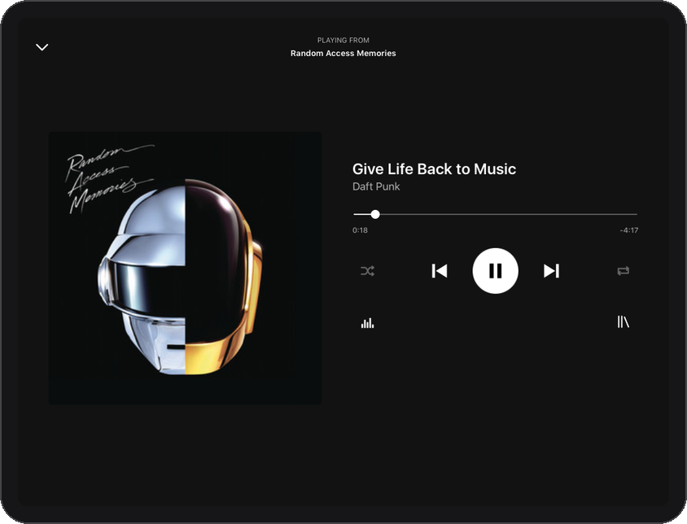
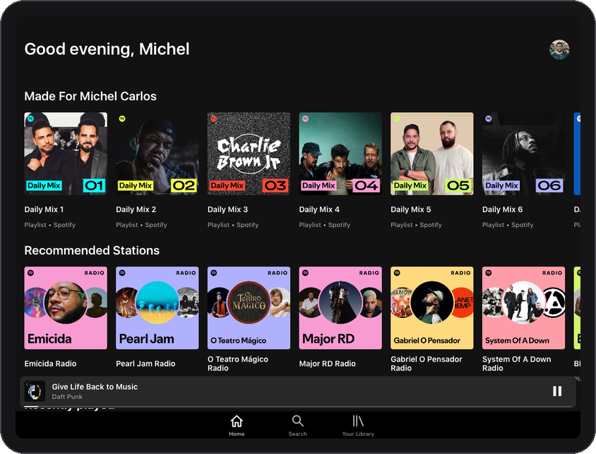
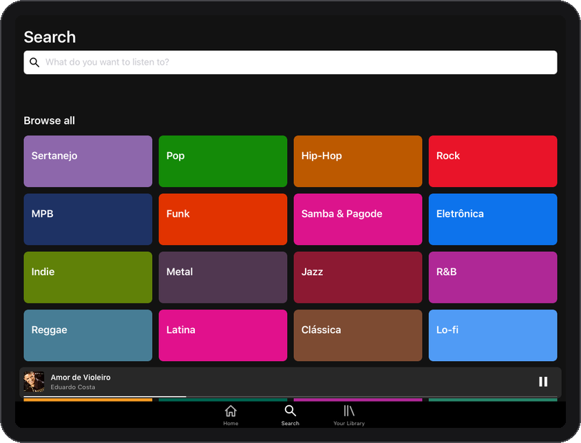
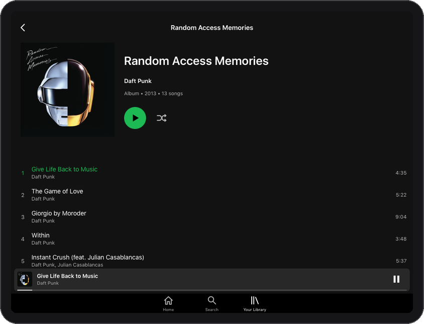
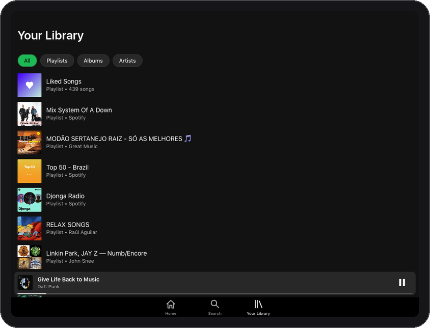
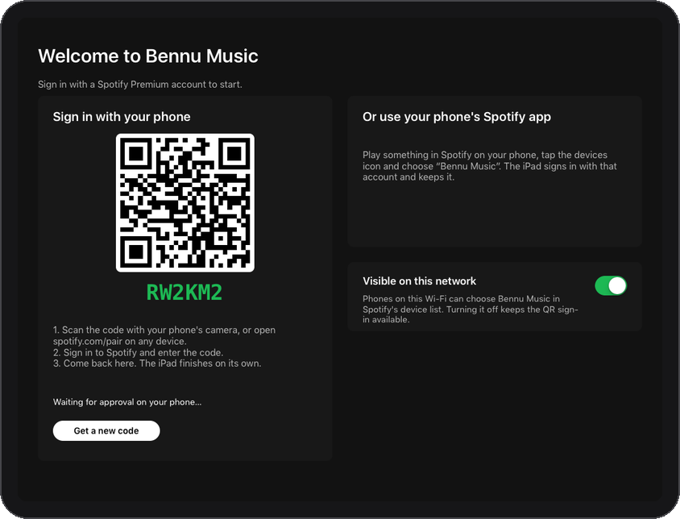
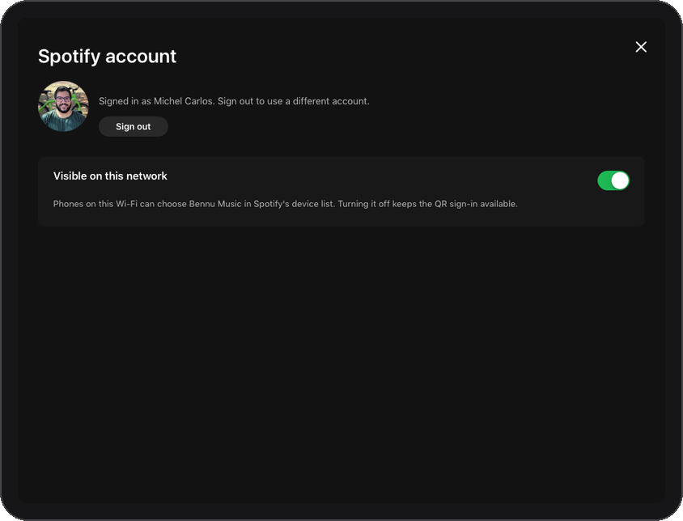
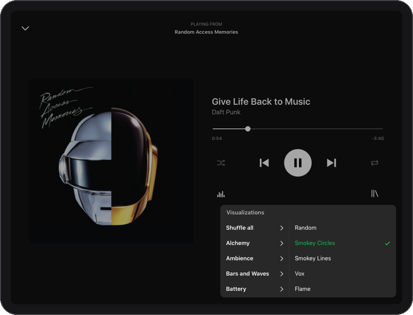

<p align="center"></p>

<h1 align="center">Bennu Music</h1>

<p align="center">Spotify on your old iPad or iPhone. A native player for jailbroken 32-bit devices stuck on iOS 9.</p>

<p align="center">
  <a href="https://github.com/micheldpcarlos/bennu-music/releases/latest"></a>
  
  
  
</p>

<p align="center"></p>

Bennu Music works two ways. Pick it from the Spotify app on your phone like any **Spotify
Connect** speaker, or use it as a **standalone player**: sign in once by scanning a QR code,
then browse, search and play on the device itself, with the screen off, nothing else in the
loop.

## Requirements

- **A 32-bit iOS device on iOS 9.3.5 or 9.3.6:** iPad 2, iPad 3, iPad 4, iPad mini (1st
  generation), iPhone 4S, iPod touch (5th generation). The iPhone 5 and 5c on iOS 10.3 should
  work too. Developed and tested on an iPad 2; phone layouts were checked at phone sizes but
  not yet on a real phone.
- **A jailbreak.** The app installs as a system app, which needs a jailbroken device.
  Jailbreaks exist for every version above (Phœnix for 9.3.5 and 9.3.6, h3lix for 10.x);
  choosing and applying one is up to you.
- **A Spotify Premium account.** Spotify Connect and streaming are Premium features. Free
  accounts cannot sign in or play.
- **Wi-Fi.** Playback with the screen off keeps Wi-Fi alive; the device otherwise drops it
  when locked.

## Install

1. On the jailbroken device, download the latest `.deb` from the
   [Releases page](https://github.com/micheldpcarlos/bennu-music/releases/latest), or copy it
   over.
2. Install it with Filza (tap the file, then Install) or over SSH with
   `dpkg -i app.bennu.music_*.deb`. The icon appears on the home screen.
3. Open Bennu Music and sign in: scan the QR code with your phone, or play something in
   Spotify on your phone and pick "Bennu Music" in the devices list.

Updates are the same `.deb` again. To remove it: `dpkg -r app.bennu.music`, or Cydia's
installed list.

## Screenshots

| Home | Search |
|---|---|
|  |  |

| Album | Your Library |
|---|---|
|  |  |

**Signing in.** Scan the QR code with your phone, or pick the device in Spotify's device list.
The account screen shows who is signed in and controls visibility on the network.

| Welcome | Account |
|---|---|
|  |  |

**Visualizations.** The Windows Media Player 9 catalog, reimplemented for a 2011 CPU.

| Alchemy | Plenoptic: Smokey Circles |
|---|---|
|  |  |

| Ambience: Down the Drain | Spikes |
|---|---|
|  |  |

<p align="center"></p>

## What it does

- **Home**: greeting, Recently played, Your playlists, Made for you (artist radios), New releases.
- **Search**: browse grid of genres, live search with Songs / Artists / Albums filters, recent searches.
- **Your Library**: Liked Songs, your playlists, recently played albums and artists.
- **Album, playlist, artist and Liked Songs pages** with Play and Shuffle; long-press a track for Play next, Go to album, Go to artist.
- **Now Playing**: artwork, scrubber with seek, shuffle, repeat (off / all / one), queue screen, lock-screen and Control Center controls.
- **Visualizations**: all Windows Media Player 9 built-ins (Alchemy, Ambience, Bars and Waves, Battery, Particle, Plenoptic, Spikes) plus a Shuffle-all mode.
- **Spotify Connect volume** is the device's system volume: the phone's slider moves it, the hardware buttons update the phone, and the level is remembered across restarts.
- **Account**: profile photo and name, in-app sign-out, a switch for visibility on the local network.
- **Resilience**: automatic reconnect after network loss, engine restart with backoff, per-feature circuit breakers for Spotify's internal endpoints.

## How it works

```
native-player/
├── cspot/                 Spotify Connect engine (vendored cspot + bell, see upstream/VENDOR.md)
├── deps/mbedtls-3.6.7/    TLS, built statically for ARMv7
├── compat/                C++17 backports for the iOS 9 libc++
├── ios/
│   ├── Catalog.cpp        Browsing data from Spotify's internal spclient endpoints
│   ├── SpclientClient.cpp Keep-alive HTTPS client used by the catalog
│   ├── PlayerBridge.cpp   C API between the engine thread and the UI
│   ├── IOSAudioQueueSink.cpp / AudioTap.cpp   AudioQueue output and the FFT tap for visualizations
│   ├── auth/              Device-authorization login, token exchange, Keychain storage
│   └── app/               The UIKit app (Objective-C, one screen per file under ui/)
└── toolchain/             (not in git) iOS 9.3 SDK and LLVM 3.8.1 libc++ headers
scripts/build.sh           Build and sign the bundle
scripts/install.sh         Install a development build over SSH
scripts/package.sh         Produce the .deb and a zip of the bundle
docs/                      Research notes and project history
```

**Engine.** The Spotify Connect side is [cspot](https://github.com/feelfreelinux/cspot),
ported to the 2016-era toolchain that iOS 9 requires (C++14, the old libc++, see
`upstream/cspot-port.patch`). It runs on a background thread, handles the protocol (Mercury,
Spirc, audio keys, CDN fetch, Vorbis decoding), reconnects on its own, and was extended with
multi-track loads, seeking, queueing and repeat. Everything reaches the UI through
`PlayerBridge`.

**Login.** The welcome screen runs Spotify's device-authorization flow (RFC 8628) and shows
the verification URL as a QR code. Approving it on a phone yields a token that the engine
turns into reusable credentials stored in the Keychain. Alternatively the device advertises
itself over mDNS and the Spotify app on the same network can pair with it. Only Spotify's own
client ids may use this flow, so the project uses the desktop client id; your own developer
app would be rejected. See `docs/ux-approach-research.md` for the research behind this choice.

**Browsing.** Spotify's public Web API rate-limits this kind of client, so the catalog uses
the same internal endpoints the official clients use, authenticated with the session's own
token: `context-resolve` (search, albums, playlists, collections, radios), `metadata/4`
and `extended-metadata` (track details, batched 50 at a time), `recently-played`,
`playlist/v2` (your playlist list and covers), `user-profile-view`. Results are cached on
disk. Covers are rewritten to JPEG variants because iOS 9 cannot decode WebP, and
mosaic covers are composed on the device. See `docs/search-alternatives.md`.

**UI.** Frame-based UIKit (no Auto Layout, no storyboards), icons drawn at runtime,
images decoded off the main thread, layouts for iPad and for 320-point phone screens. The
visualizer renders a half-resolution bitmap that the GPU scales
(`docs/visualization-research.md` documents the presets).

## Building from source

You only need this to change the app. Users should install the `.deb` above.

**Prerequisites:** a Mac with Xcode command-line tools, CMake, Python 3 and
[ldid](https://github.com/ProcursusTeam/ldid) (`brew install cmake ldid`), plus two inputs
that are not in the repository because of their licenses and size:

| Path | What | Where to get it |
|---|---|---|
| `native-player/toolchain/iPhoneOS9.3.sdk` | Apple's iOS 9.3 SDK | Inside Xcode 7.3 (`Xcode.app/Contents/Developer/Platforms/iPhoneOS.platform/Developer/SDKs/iPhoneOS9.3.sdk`) |
| `native-player/toolchain/libcxx-3.8.1.src` | LLVM 3.8.1 libc++ source (only `include/` is used) | https://releases.llvm.org/3.8.1/libcxx-3.8.1.src.tar.xz |

The build script creates a normalized overlay of the SDK under `native-player/ios/build/`
(text stubs rewritten so the modern linker accepts the ARMv7 exports); the original SDK is
not modified. `IPAD_ORIGINAL_SDK` and `IPAD_CXX_HEADERS` override the paths.

```sh
python3 -m venv native-player/build-venv
source native-player/build-venv/bin/activate
pip install -r native-player/ios/requirements-build.txt protobuf grpcio-tools
scripts/build.sh                                  # native-player/ios/build/BennuMusic.app
IPAD=root@<device address> scripts/install.sh     # staged install over SSH, keeps .previous for rollback
scripts/package.sh                                # dist/*.deb and a zip of the bundle
```

The bundle has one executable named after its hash, signed with `ldid` and a private
Keychain access group.

## Developer tools

The app registers the `bennu://` URL scheme so it can be driven over SSH with `uiopen`:

| URL | Effect |
|---|---|
| `bennu://screenshot`, `bennu://record?frames=24%26ms=150` | Writes `Documents/bennu-screen.png`, or a burst of JPEG frames for GIFs |
| `bennu://window?w=320%26h=568`, `bennu://rotate?o=portrait` | Preview phone layouts and orientations on an iPad (no parameters restores the screen size) |
| `bennu://tab?n=0..2`, `bennu://back`, `bennu://scroll?y=800` | Navigation |
| `bennu://search?q=...`, `bennu://open?uri=spotify:album:...`, `bennu://play?uri=...` | Browsing and playback |
| `bennu://nowplaying`, `bennu://seek?ms=266000`, `bennu://volume?v=32768`, `bennu://repeat?mode=1`, `bennu://enqueue?uri=...` | Player |
| `bennu://viz?family=Battery%26preset=brightsphere`, `bennu://vizmenu` | Visualizer |
| `bennu://setup`, `bennu://signout`, `bennu://visible?on=0`, `bennu://drop` | Account, visibility, simulated connection loss |

Separate query parameters with `%26` when the URL goes through `ssh`; the device's shell
splits on `&` and `;`. The engine's log is `Documents/cspot-app.log`. Dropping a
`Documents/bennu-probe.txt` (one URL per line) makes the engine fetch each URL with the
session token at startup, which is how the catalog endpoints were explored.
`Documents/bennu-catalog-flags.json` (for example `{"search": false}`) disables a request
kind without a rebuild.

## Known limits

- No write operations yet (like, add to playlist, follow).
- Artist and album search is derived from matching tracks; artists with no matching tracks
  do not appear. Spotify's dedicated search endpoint rejects this client.
- Spotify changes its internal endpoints a few times a year. The catalog degrades
  per-feature (a screen says browsing is unavailable; Spotify Connect keeps working).
- The visualizer presets follow the WMP wiki's descriptions; the original gallery images
  were not available, so they are interpretations.

## Documents

- `docs/ux-approach-research.md`: why device authorization with Spotify's client id, and the alternatives.
- `docs/search-alternatives.md`: how every catalog endpoint was found and what failed.
- `docs/visualization-research.md`: WMP 9 preset catalog and engine notes.
- `docs/history/`: dated checkpoints from the port, including the earlier Linux-boot route.
- `native-player/upstream/VENDOR.md`: provenance of vendored code and the port patches.
- `THIRD_PARTY.md`, `CONTRIBUTING.md`, `SECURITY.md`, `CHANGELOG.md`.

## License

GPL-3.0-or-later. See `LICENSE` and `THIRD_PARTY.md`. Not affiliated with or endorsed by
Spotify.
